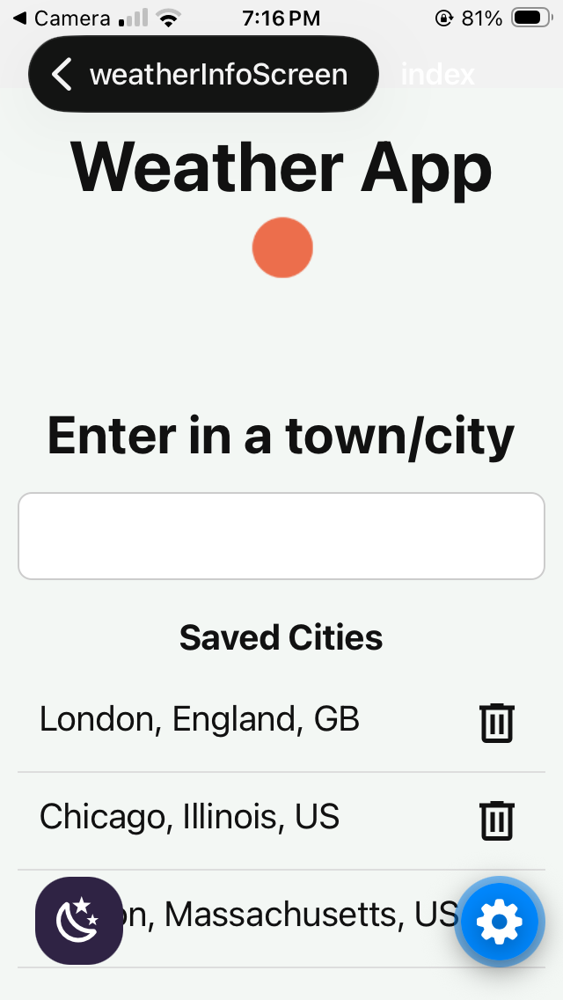
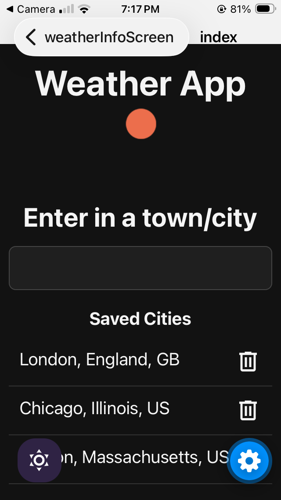
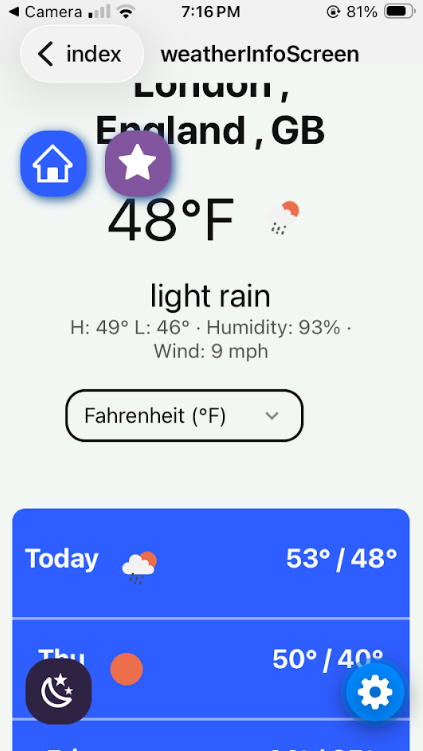

# Weather App
An app using react Native that allows you to look at the weather and 5-day forecast of any location using an API key

## Features
   - Search any city
   - 5 day weather forecast
   - Save/delete cities
   - Light/Dark mode

## Technologies Used

    - React Native
    - TypeScript
	- Weather API
	- SQLite

# Screenshots

